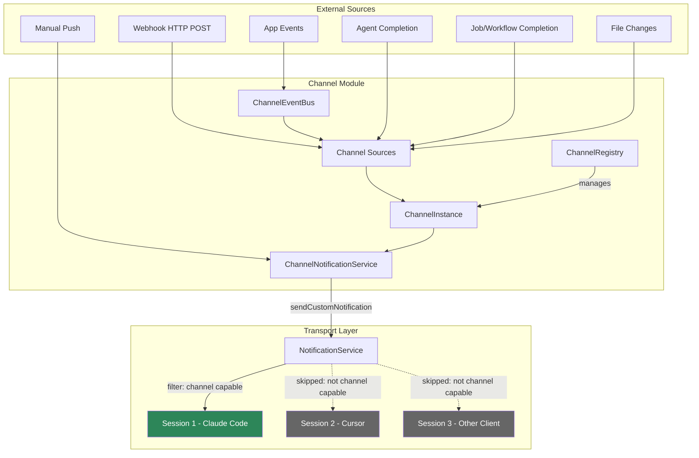
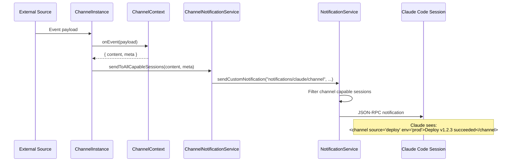
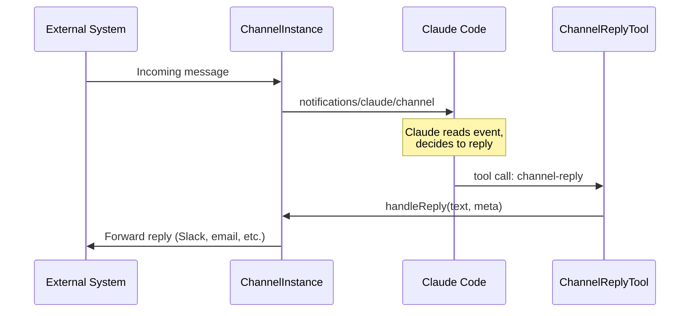
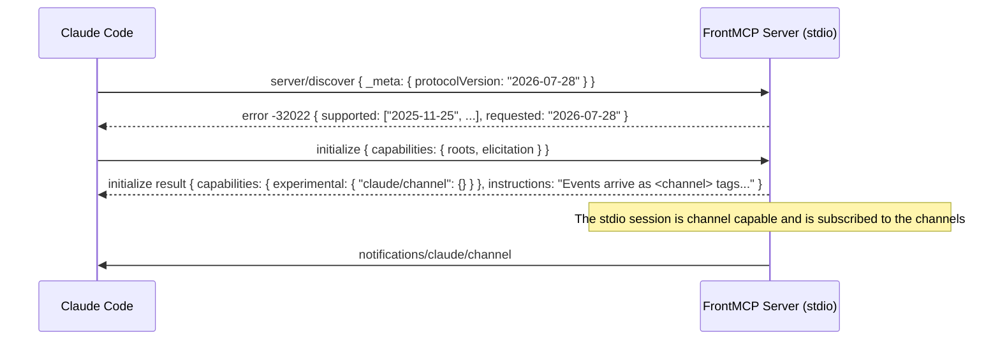
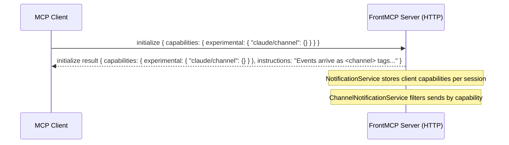
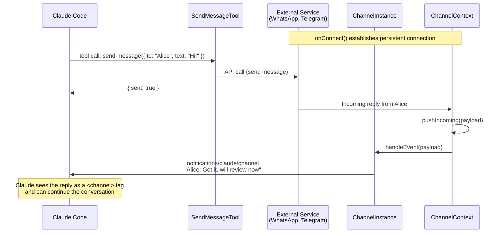
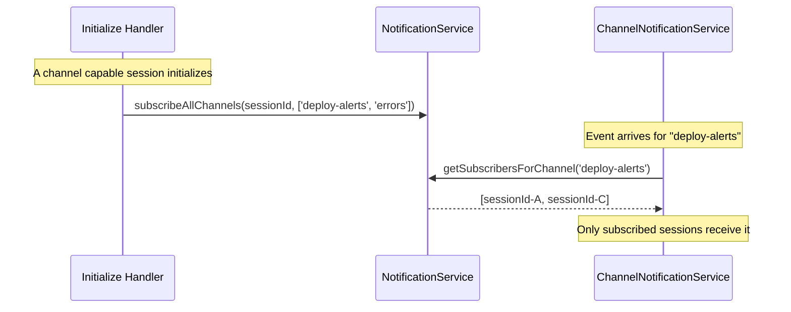

# FrontMCP Channels

Push-based notification channels for Claude Code and other MCP clients that support the `notifications/claude/channel` experimental extension.

## Architecture



## Notification Flow



## Two-Way Communication



## Capability Handshake

A session gets channel notifications when it is **channel capable**. The rule depends on the transport
(`isChannelCapableSession()` in `notification.service.ts`).

### Stdio: no declaration, 2026-07-28 declined

Claude Code spawns a channel server over stdio. It never declares `experimental['claude/channel']`: it registers
a channel from the capability the server advertises and from its own flags. So the stdio session is channel
capable with no client declaration.

Claude Code delivers channel events only on a session, and it probes a stdio server with `server/discover` on
revision 2026-07-28 first. A server that serves channels declines that revision over stdio: `server/discover` and
every other 2026-07-28 request get `-32022` with the earlier revisions in `data.supported`, and 2026-07-28
notifications are ignored. Claude Code then sends `initialize`. `servesClaudeCodeChannels()` in `channel.utils.ts`
decides whether a scope serves channels: it has a channel, or an event with the `channel` option.
`StdioRevisionRouter` declines.



This covers `runStdio()`, a `--stdio` server and `frontmcp dev --stdio --serve`. `runShared()` and
`frontmcp dev --stdio` without `--serve` bridge stdio to an HTTP server, so the HTTP rule applies to them.

### HTTP: declaration required

Over HTTP a client declares the capability, and a session that declares nothing gets no channel notification.
HTTP serves revision 2026-07-28 as before: there, a `subscriptions/listen` request carries the declaration in its
client capabilities.



## Service Connector Pattern



Service connectors maintain persistent connections to external messaging services.
Claude sends messages via channel-contributed tools and receives responses as channel notifications.

```typescript
@Channel({
  name: 'whatsapp',
  source: { type: 'service', service: 'whatsapp-business' },
  tools: [SendWhatsAppTool], // Claude calls this to send messages
  twoWay: true,
})
class WhatsAppChannel extends ChannelContext {
  private client: WhatsAppClient;

  async onConnect(): Promise<void> {
    this.client = new WhatsAppClient(process.env['WA_TOKEN']);
    this.client.on('message', (msg) => this.pushIncoming(msg));
    await this.client.connect();
  }

  async onDisconnect(): Promise<void> {
    await this.client.disconnect();
  }

  async onEvent(payload: unknown): Promise<ChannelNotification> {
    const msg = payload as { from: string; text: string; chatId: string };
    return { content: `${msg.from}: ${msg.text}`, meta: { chat_id: msg.chatId } };
  }
}
```

## Module Structure

```
channel/
├── index.ts                           # Barrel exports
├── channel.events.ts                  # ChannelEmitter + ChannelChangeEvent
├── channel.instance.ts                # Concrete ChannelEntry implementation
├── channel.registry.ts                # Registry (extends RegistryAbstract)
├── channel.types.ts                   # IndexedChannel row type
├── channel.utils.ts                   # normalizeChannel() helpers
├── channel-notification.service.ts    # Sends notifications/claude/channel
├── channel-scope.helper.ts            # Orchestrates registration in Scope
├── flows/
│   ├── send-channel-notification.flow.ts  # Programmatic send flow
│   └── list-channels.flow.ts              # Health/status listing flow
├── reply/
│   ├── channel-reply.tool.ts          # Auto-registered reply tool
│   └── reply.types.ts                 # Reply input schema
└── sources/
    ├── index.ts                       # Source barrel
    ├── agent-completion.source.ts     # Subscribes to AgentEmitter
    ├── job-completion.source.ts       # Subscribes to JobEmitter
    ├── webhook.source.ts              # HTTP POST middleware
    ├── app-event.source.ts            # In-process ChannelEventBus
    └── file-watcher.source.ts         # Watches the declared paths with watchFiles
```

## How It Works

### 1. Declaration

Channels are declared using `@Channel()` decorator or `channel()` function builder:

```typescript
@Channel({
  name: 'deploy-alerts',
  description: 'CI/CD deployment notifications',
  source: { type: 'webhook', path: '/hooks/deploy' },
  twoWay: true,
  meta: { team: 'platform' },
})
class DeployChannel extends ChannelContext {
  async onEvent(payload: unknown): Promise<ChannelNotification> {
    const data = payload as { body: { status: string; version: string } };
    return {
      content: `Deploy ${data.body.status}: ${data.body.version}`,
      meta: { env: 'production' },
    };
  }

  async onReply(reply: string): Promise<void> {
    await sendToSlack(reply);
  }
}
```

### 2. Registration

Channels are registered via app metadata:

```typescript
@App({
  name: 'DevOps',
  channels: [DeployChannel, ErrorChannel],
})
class DevOpsApp {}
```

And enabled at the server level:

```typescript
@FrontMcp({
  info: { name: 'my-server', version: '1.0.0' },
  apps: [DevOpsApp],
  channels: { enabled: true },
})
class Server {}
```

### 3. Scope Initialization

During `Scope.initialize()` (Batch 3, after NotificationService is ready):

1. `registerChannelCapabilities()` creates the `ChannelRegistry`
2. Each `ChannelInstance` gets a reference to `ChannelNotificationService`
3. Sources are wired: agent emitters, job emitters, event bus subscriptions
4. If any channel is `twoWay`, the `ChannelReplyTool` is auto-registered in `ToolRegistry`
5. Channel flows are registered in `FlowRegistry`
6. `connectServices()` runs `onConnect()` on each `service` and `file-watcher` channel, and starts the watch of a
   `file-watcher` channel's declared paths

### 4. Capability Advertisement

`channelCapabilitiesOf(scope)` in `channel.utils.ts` returns, for a scope that serves channels
(`servesClaudeCodeChannels()`):

```json
{ "experimental": { "claude/channel": {} } }
```

This is merged into the MCP server's capabilities during transport setup (local adapter, stdio, unix socket).

### 5. Session-Scoped Notification Delivery

Channel notifications are **session-scoped** — each session only receives notifications
from channels it is subscribed to. This prevents data leaking between connected agents.



When an event arrives:

1. Source triggers `ChannelInstance.handleEvent(payload)`
2. Instance creates a `ChannelContext` and calls `onEvent(payload)`
3. The returned `ChannelNotification` is merged with static metadata
4. `ChannelNotificationService.sendToSubscribedSessions()` is called
5. `NotificationService.getSubscribersForChannel(channelName)` returns only subscribed sessions
6. Each subscribed session is also checked with `isChannelCapableSession()`: the stdio session always passes, an
   HTTP session passes when its client declared `experimental: { 'claude/channel': {} }`
7. Only subscribed + capable sessions receive the JSON-RPC notification

**Auto-subscription:** When a channel capable session initializes, it is automatically subscribed to the channels
the hookable `channels:list` flow returns. An HTTP session is channel capable when its `initialize` declares
`experimental: { 'claude/channel': {} }`; the stdio session needs no declaration. This happens in
`initialize-request.handler.ts` for both.

**Manual subscription:** For fine-grained control, use `scope.notifications.subscribeChannel(sessionId, channelName)`.

**Unsubscription:** Channel subscriptions are cleaned up automatically when a session disconnects
(`unregisterServer()` removes all resource and channel subscriptions).

## Events as Channel Notifications

An `@Event` with the `channel` option is sent to channel capable sessions as `notifications/claude/channel` each time
it is published. It does not go through this module's registry or its `channels:send-notification` flow.

- The `notifyChannelSessions` stage of `events:publish` (`event/flows/event-publish.flow.ts`) sends it, after
  `bridgeToBus`. `event/event-channel.ts` builds the message: the payload as JSON or the option's `content`, and
  `event` and `event_id` beside the option's `meta`.
- It goes to `NotificationService.getChannelCapableSessions()`, with no channel subscription. Each session is checked
  against the event's own rules, as the caller of its latest request (`RegisteredServer.caller`):
  `availableWhen.surface`, the `audience` of the publish, the event's `authorities` and `authorize()`. An occurrence
  published for a `subscriptionId` goes to no session.
- `LocalTransportAdapter.ensureAuthInfo()` keeps that caller on every request of an HTTP session, and
  `createInMemoryServer()` when it is created and on `setAuthInfo()`: the verified user, scopes and claims, and
  when the credentials expire (`sessionCallerOf()`), never the token. The expiry is the auth info's `expiresAt`, or
  the user's `exp` claim; nothing is read from the token itself, so an in-memory session expires only when its auth
  info gives one of the two. The stdio session keeps no caller and is anonymous. A session whose caller's
  credentials have expired (`hasExpiredCaller()`) is sent nothing.
- Such an event makes `servesClaudeCodeChannels()` true with no `@Channel` and no `channels: { enabled: true }`.
  `channels: { enabled: false }` turns the option off, with one warning at startup.
- A `subscriptions/listen` stream of revision 2026-07-28 gets no event this way: such a client opens `events/stream`.
- An `app-event` channel named after a declared event still gets each occurrence from the bus. At startup
  `describeEventChannels()` in `event/event-scope.helper.ts` logs one line for each: a warning when the event has the
  `channel` option too (a session gets each occurrence twice), an info line when it has not (the option replaces the
  channel). It logs nothing with `events.bridge: false`.

## Source Types

| Source             | Trigger                                                     | Config                                                                      |
| ------------------ | ----------------------------------------------------------- | --------------------------------------------------------------------------- |
| `webhook`          | HTTP POST to configured path                                | `{ type: 'webhook', path: '/hooks/deploy' }`                                |
| `app-event`        | In-process event bus emit                                   | `{ type: 'app-event', event: 'error' }`                                     |
| `agent-completion` | Agent finishes execution                                    | `{ type: 'agent-completion', agentIds?: ['reviewer'] }`                     |
| `job-completion`   | Job/workflow completes                                      | `{ type: 'job-completion', jobNames?: ['daily-report'] }`                   |
| `service`          | Persistent connection to external service                   | `{ type: 'service', service: 'whatsapp-business' }`                         |
| `file-watcher`     | A file of the declared paths is created, changed or removed | `{ type: 'file-watcher', paths: ['./logs'], events: ['create', 'change'] }` |
| `manual`           | Programmatic push                                           | `{ type: 'manual' }`                                                        |

### File Watcher Source

`wireFileWatcherSource()` in `sources/file-watcher.source.ts` watches the declared `paths` with `watchFiles` from
`@frontmcp/utils`, and hands each file event to `ChannelInstance.handleEvent()`.

- **Lifetime.** `ChannelInstance.connectService()` starts the watch after `onConnect()`.
  `disconnectService()` aborts its signal before `onDisconnect()`, so the watch ends when the channel disconnects, and
  at shutdown and `dispose()`, which disconnect every channel.
- **Payload.** `onEvent()` gets a `ChannelFileEvent`, `{ event: 'create' | 'change' | 'delete', path }`, with `path`
  absolute. `watchFiles` yields `add`, `change` and `unlink`: they are renamed to the source's own event names.
- **Events.** `events` selects the kinds to hand over; none declared means every kind. `rename` selects `create` and
  `delete`: a renamed file is gone from one path and appears at another.
- **Paths.** Files or directories, as `watchFiles` takes them. A path is not expanded as a glob: one with `*` is
  watched as written, with a warning.
- **Where it does not run.** `isLongLivedProcess()` is false in a serverless, edge or browser runtime: nothing is
  watched, a warning is logged, and `onConnect()` still runs. CLI mode and `createForManifest()` drop the `channels`
  config, so they register no channel. A detached job runner connects no channel.
- **Failure.** A watch that fails is logged, and the channel stays connected.
- **Browser bundle.** `watchFiles` is imported from `@frontmcp/utils`, which loads `fs` on first use, and this module
  is under `channel/`, which a bundle loads only when the server enables channels.

## Wire Protocol

Channel notifications use the `notifications/claude/channel` JSON-RPC method:

```json
{
  "jsonrpc": "2.0",
  "method": "notifications/claude/channel",
  "params": {
    "content": "Deploy succeeded: v1.2.3",
    "meta": {
      "source": "deploy-alerts",
      "team": "platform",
      "env": "production"
    }
  }
}
```

In Claude Code, this renders as:

```xml
<channel source="deploy-alerts" team="platform" env="production">
Deploy succeeded: v1.2.3
</channel>
```

Claude Code drops a `meta` key that has anything but letters, digits and underscores. `channelMetaOf()` in
`channel.utils.ts` makes the keys of every notification safe before it is sent: any other character becomes `_`
(`chat-id` is sent as `chat_id`), an empty key and a missing value are left out, and values are sent as strings.
`ChannelNotificationService` applies it, and so does an event with the `channel` option.

## Key Classes

| Class                        | Purpose                                                             |
| ---------------------------- | ------------------------------------------------------------------- |
| `ChannelContext`             | Abstract base for channel handlers (extends `ExecutionContextBase`) |
| `ChannelEntry`               | Abstract entry in registry (extends `BaseEntry`)                    |
| `ChannelInstance`            | Concrete entry with event handling and notification push            |
| `ChannelRegistry`            | Manages channel entries, provides capabilities                      |
| `ChannelNotificationService` | Sends `notifications/claude/channel` to capable sessions            |
| `ChannelEmitter`             | Pub/sub for registry change events                                  |
| `ChannelEventBus`            | In-process event bus for `app-event` sources                        |
| `ChannelReplyTool`           | Auto-registered tool for two-way channels                           |
